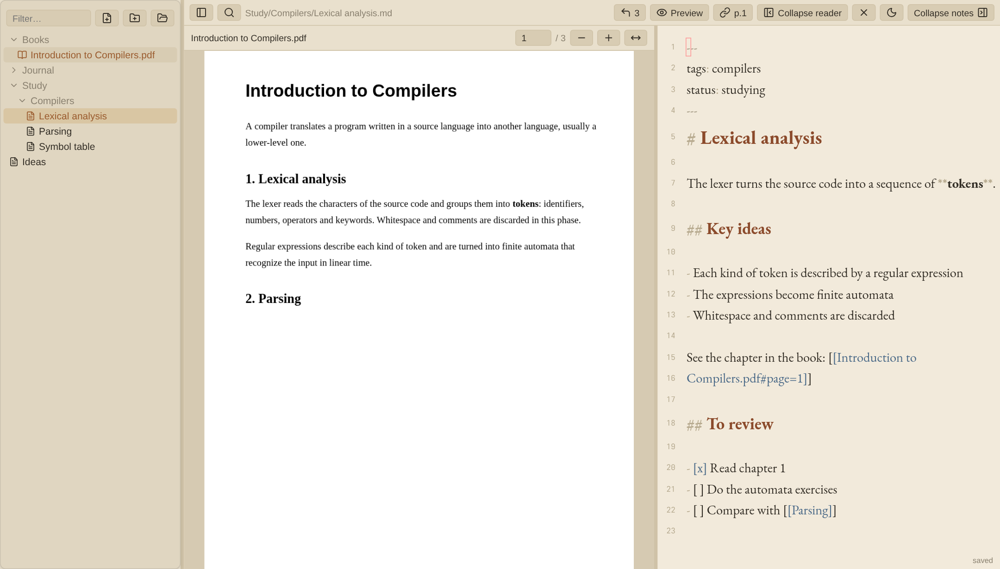
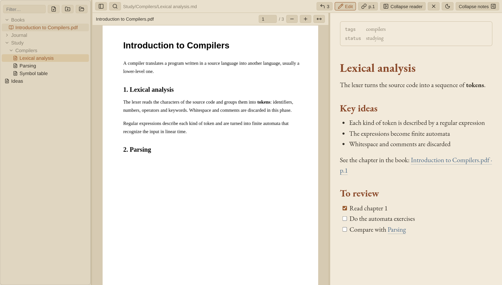
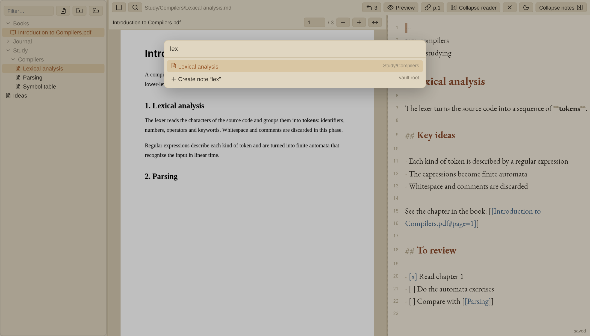
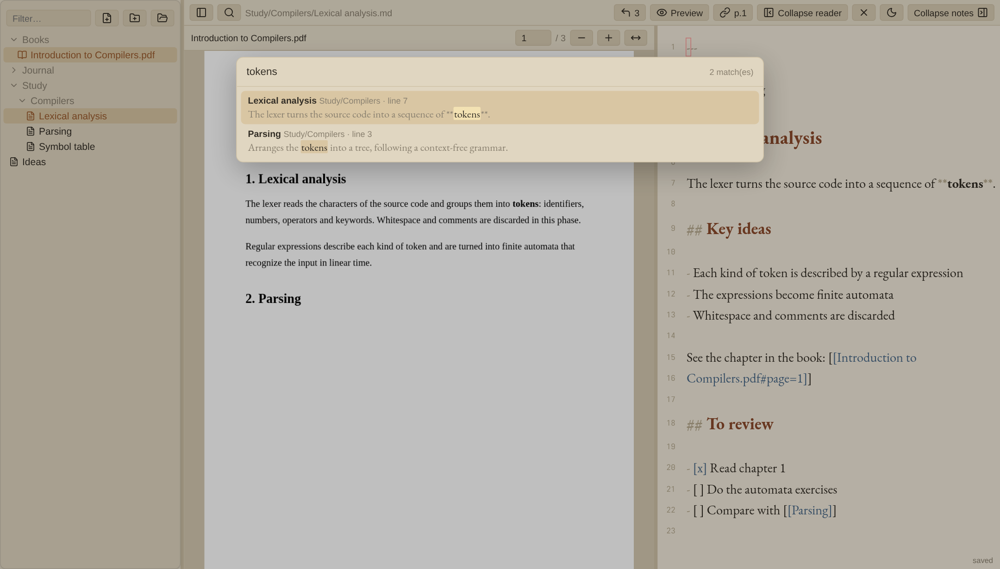
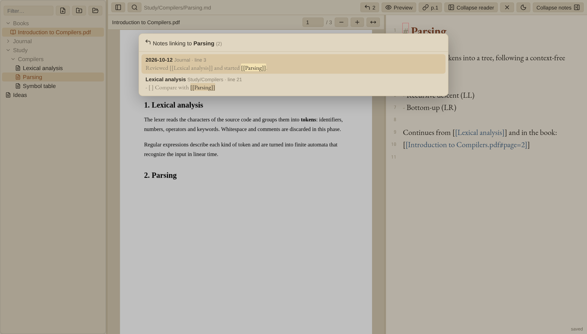
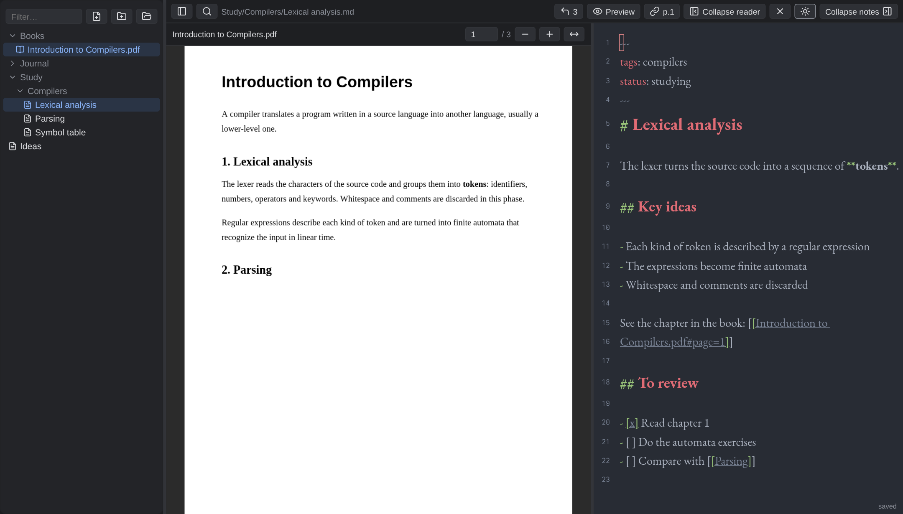

# Quirenote

*[Leia em português](README.pt-BR.md)*

A PDF/EPUB reader and a markdown note editor (with vim mode) side by side, on top of an Obsidian vault,
served by a single Go binary. The vault's `.md` files are the source of truth (no database): Neovim, Obsidian
and the browser all edit the same files.



## Features

**Reader and notes side by side.** The PDF (or EPUB) sits on the left and the note on the right; both panels
collapse and resize. `Ctrl+Shift+L` inserts a link to the current page, and clicking it takes you right back there.

**Markdown preview** (`Ctrl+E`): headings, `[[links]]`, images, properties and clickable tasks.



**Quick switcher** (`Ctrl+O`) by name, accent-insensitive, and **full-text search** (`Ctrl+Shift+F`) with highlighted snippets.

 

**Backlinks** (the ↩ N button): which notes link to the open note.



**Dark theme** (moon/sun button at the top):



## Usage

```sh
make dev        # Go :8080 + Vite :5173 (open http://localhost:5173)
make build      # builds bin/quirenote with the frontend embedded
make install    # installs to ~/.local/bin + a systemd --user unit
systemctl --user enable --now quirenote
make check      # gofmt, vet, staticcheck, errcheck, nilaway, tests with -race, svelte-check
```

Flags/variables: `-vault` / `QUIRENOTE_VAULT` (default `~/Documents/NotasObsidian/Notas`),
`-addr` / `QUIRENOTE_ADDR` (default `127.0.0.1:8080`). For remote access, set `QUIRENOTE_ADDR` in the unit to
the machine's NetBird IP; anyone on that network can access it without logging in.

## Shortcuts

| Shortcut | Action |
|---|---|
| `Ctrl+\` / `Alt+\` / `Ctrl+Shift+\` | collapse notes / reader / sidebar |
| `Ctrl+E` | toggle preview / editing |
| `Ctrl+O` / `Ctrl+P` | quick switcher for notes and PDFs (Shift+Enter creates) |
| `Ctrl+Shift+F` | full-text search (requires ripgrep) |
| `Ctrl+Shift+O` | note outline |
| `[[` | link autocompletion |
| `Ctrl+click` / `Ctrl+Enter` | follow a `[[link]]`; on a task, toggles `[ ]`/`[x]` |
| `Ctrl+Shift+L` | insert a link to the reader's current position (`#page=N` or `#cfi=…`) |
| `Alt+↑/↓` · `Alt+Shift+↑/↓` | scroll · turn the reader's page without leaving the editor |
| `Tab` / `Shift+Tab` | indent / outdent |
| `:w` / `Ctrl+S` | save (it also autosaves after 1 s) |

- Sidebar: new note, new folder (also inside each folder) and open a PDF/EPUB from the device without
  uploading anything. Right click: rename/move (updates the `[[links]]`) and trash (the vault's `.trash`;
  nothing is deleted).
- Pasting or dropping an image stores it in Obsidian's attachment folder and inserts `![[…]]`.
- **↩ N** in the top bar lists the backlinks. Dividers are draggable; double-click resets them.

## Desktop app (Omarchy)

`make install` installs `quirenote-app`, the "Quirenote" launcher entry and the icon. `quirenote-app` opens
Quirenote in a Chromium app window (no address bar) with its own lightweight profile, starts the systemd
service if it is down and, if the window already exists, just focuses it. On Hyprland: `SUPER+SHIFT+L`
(in `~/.config/hypr/bindings.lua`: `o.bind("SUPER + SHIFT + L", "Quirenote", { launch = "quirenote-app" })`).
It can also be installed as a PWA.

## Look

"Paper" light theme (the moon/sun button switches to dark) and embedded EB Garamond.
Colors: `web/src/lib/theme.ts` and `web/src/app.css`.

## Structure

Go (`net/http`, `os.Root` confines access to the vault, atomic writes, mtime-based conflict detection,
fsnotify + SSE) in `cmd/` and `internal/`; Svelte 5 + CodeMirror 6 + PDF.js + foliate-js frontend in `web/`.
The `mtime` travels as a string in JSON because in nanoseconds it loses precision in a JS `Number`. The page
has a `script-src 'self'` CSP, which also blocks JavaScript embedded in EPUBs.

Icons: [Lucide](https://lucide.dev) (ISC license); they inherit the theme color.
