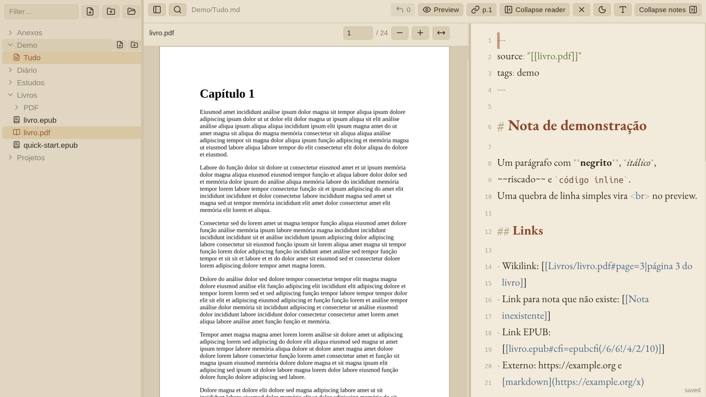

# Quirenote

*[Leia em português](README.pt-BR.md)*

A native Rust application for Markdown notes, with a PDF/EPUB reader beside the editor. The interface uses egui and the backend uses Axum. Notes remain ordinary files in your chosen folder; Obsidian links, attachments and trash are supported.



## Build and run

Requires a current Rust toolchain, Linux, ripgrep, fontconfig, and the development libraries for Poppler GLib, Cairo, GLib, xkbcommon and Wayland/X11. On Arch, the corresponding packages include `rust`, `ripgrep`, `fontconfig`, `poppler-glib`, `cairo`, `glib2`, `libxkbcommon`, `wayland`, `libx11` and `libxrandr`. Cargo downloads the locked dependencies on the first build; use `CARGO_FLAGS="--offline --locked"` when they are already cached.

```sh
make check       # rustfmt, strict Clippy, backend and GUI tests, shell syntax
make build       # release binaries: bin/quirenote and bin/quirenote-gui
make dev         # debug backend + native window; stops its backend when the window closes
make install     # installs both Rust binaries, launcher, icon and user service
quirenote-app    # starts the local service if needed, then opens the native interface
```

Builds use one Cargo job by default to limit RAM usage. Override `CARGO_JOBS`, `SERVER_TARGET_DIR` or `GUI_TARGET_DIR` if needed. `make dev-api` and `make dev-gui` run the components separately. Restart development mode after source changes.

To run the release binaries without installing:

```sh
bin/quirenote -addr 127.0.0.1:8080
# In another terminal:
bin/quirenote-gui --server http://127.0.0.1:8080
```

## Your notes

First run offers a new folder or an existing vault. The choice is stored in `~/.config/quirenote/config.toml`; existing Obsidian files are used in place. Once configured, change the vault from the terminal:

```sh
bin/quirenote init ~/Notes
bin/quirenote init
```

The backend accepts `-vault` / `QUIRENOTE_VAULT` and `-addr` / `QUIRENOTE_ADDR`. The GUI accepts `--server` / `QUIRENOTE_URL`, `--note`, `--doc`, `--page`, and `--state-dir`. Preferences and the last session are stored under `$XDG_STATE_HOME/quirenote-gui` (normally `~/.local/state/quirenote-gui`). The HTTP port serves the native client's API. Remote users need the native client and network access to the backend; there is no browser UI on main and no login on this API.

## Controls

| Shortcut | Action |
|---|---|
| `Ctrl+O` / `Ctrl+P` | quick switcher |
| `Ctrl+Shift+F` | full-text search |
| `Ctrl+Shift+O` | note outline |
| `Ctrl+E` | editor / Markdown preview |
| `Ctrl+S` / `:w` | save (also autosaves) |
| `Ctrl+Shift+L` | insert a link to the reader position |
| `Alt+↑/↓` / `Alt+Shift+↑/↓` | scroll / page the reader |
| `Ctrl+\` / `Alt+\` / `Ctrl+Shift+\` | collapse notes / reader / sidebar |

The editor supports Vim motions, Obsidian wikilinks, images, undo and redo. The toolbar offers theme and per-role font choices. PDF pages use Poppler; EPUB content and Markdown preview are rendered natively.

## Implementation and history

`rust/` contains the confined vault, atomic saves, version conflicts, first-run setup, search, relinking and live updates. `gui/` contains the native application, embedded fonts, Markdown editor and readers. `deploy/` and the Makefile install and launch the two Rust binaries.

The previous Go backend and Svelte/Chromium interface are preserved on **`backup/go-svelte-2026-10-14`**. Use a separate worktree to inspect or build that version without replacing this checkout. Historical backend benchmarks remain on `bench/rust-axum-vs-go`; the [GUI memory report](docs/gui-memory-2026-10-14/RELATORIO.pt-BR.md) records a measured 80–85% reduction in client PSS on the benchmark machine. This is an architecture comparison, not a universal language guarantee or a complete parity claim.

Native rendering still differs in layout and EPUB reflow, and help shortcuts can clip at narrow widths. Rename relinking reads a snapshot of all visible notes and conditionally saves affected files; conflicting edits are reported as skipped rather than overwritten.

Fonts: EB Garamond (OFL). Icons: Lucide (ISC); licenses are in `gui/assets/fonts/`.
