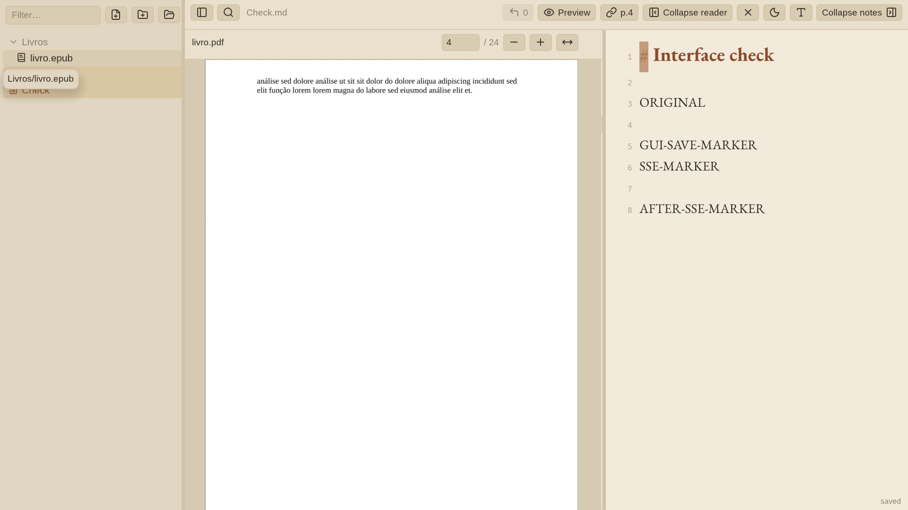
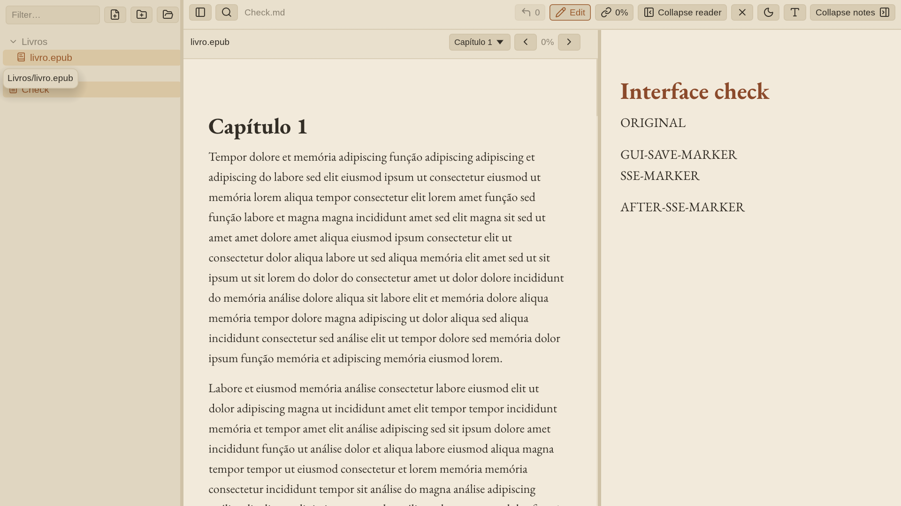

# Promoção da aplicação Rust para main

A main local agora usa o backend Rust/Axum e a interface nativa Rust/egui. O commit de código verificado e compilado é `b6f05f93ea72a9052423ad388a2183871faebd2b`. A versão anterior da main, `bee0c18`, foi preservada na branch `backup/go-svelte-2026-10-14`. Os fontes antigos também estão recuperáveis em `.claude/go-backup-2026-10-14/`; o inventário confere SHA256 de 103 arquivos. A remoção da árvore ativa foi feita por arquivamento e retirada do índice, preservando os arquivos.

O Makefile compila, verifica e instala os dois componentes Rust. O lançador inicia o serviço local quando necessário e abre `quirenote-gui`. O backend serve a API e deixou de embutir o frontend web; o build atual não depende de Go, Node ou Chromium. Os ícones foram movidos para `assets/`, e os READMEs e AGENTS.md refletem o fluxo nativo.

Foram incorporadas as duas correções do PDF já medidas no benchmark. A GUI foi formatada e teve os 86 avisos herdados corrigidos sem adicionar suppressions. A falha de descoberta de links durante saves atômicos foi corrigida: o relink lê um snapshot completo de notas regulares e visíveis na fila de escrita e salva com verificação de versão. Conflitos continuam sendo informados como ignorados, preservando as edições concorrentes.

## Verificação na main integrada

- `make check`: passou; rustfmt e Clippy em todos os targets com `-D warnings`, **73 testes** (38 unitários de backend, 5 API, 30 GUI) e sintaxe shell.
- Regressão concorrente de relink: **30/30 rodadas** no binário de testes da main, com 200 referências e 16 editores; preservação de tokens aceitos e contabilização de referências atualizadas/ignoradas.
- `make build`: passou, release offline e locked, um job, usando caches no disco. Backend: 42 s; GUI: 2 min 55 s.
- **6/6 checks nos executáveis release:** configuração inicial persistida e bloqueada após setup; save e conflito; rename/relink por HTTP; API sem frontend de navegador; restauração após reinício; `init` em pasta sintética isolada.
- **5/5 fluxos na janela nativa:** edição/autosave; restauração da nota; alteração externa seguida de edição preservando conteúdos; PDF na página 4; EPUB com posição de leitura e preview Markdown. Capturas inspecionadas mostram os conteúdos renderizados.
- Lançador testado em cópia temporária instalada com modo 755, como no Makefile. O processo resultante executou exatamente `bin/quirenote-gui` e abriu a nota de teste. A tentativa inicial de executar diretamente o fonte modo 644 falhou por permissão; a instalação aplica o modo executável.
- Desktop entry, unidade systemd, sintaxe dos scripts Python e links locais dos READMEs conferidos. `systemd-analyze` emitiu um aviso de uma unidade já instalada `omarchy-sync.service`, sem erro na unidade Quirenote.

[Resultados estruturados e hashes](rust-promotion-2026-10-14/verification.json), [check completo](rust-promotion-2026-10-14/check.log), [build release](rust-promotion-2026-10-14/build.log), [API/CLI](rust-promotion-2026-10-14/api-result.json), [fluxos nativos](rust-promotion-2026-10-14/native-flow/result.json).





## Artefatos e execução

- `bin/quirenote`: backend release Rust, 3.399.696 bytes.
- `bin/quirenote-gui`: interface release Rust, 16.850.576 bytes.

```sh
bin/quirenote -addr 127.0.0.1:8080
# Em outro terminal:
bin/quirenote-gui --server http://127.0.0.1:8080
```

A integração é local; não foram substituídos serviços/binários instalados no sistema nem publicadas branches remotas. Os testes usaram vaults sintéticos e compositor privado, encerrado ao final. A janela aberta para avaliação do usuário foi preservada.

## Limites

Não foi estabelecida equivalência completa de funcionalidades, geometria e reflow com a interface antiga, nem feito teste longo de vazamento. O snapshot de relink lê todas as notas enquanto ocupa a fila de escrita; sua memória e latência ainda não foram medidas numa nova campanha. O [benchmark de memória anterior](gui-memory-2026-10-14/RELATORIO.pt-BR.md) permanece histórico e descreve seus próprios binários, anteriores à promoção.
